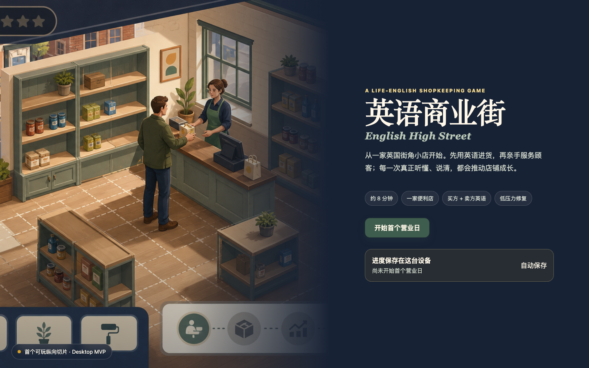

# 英语商业街 · English High Street

当前可运行代码是依据 PRD v0.1 制作的 **2D 桌面浏览器 MVP**。[现行 PRD v0.2](./docs/PRD.md)已于 2026-08-30 更新为第一人称 3D 和分层升级，尚未完成代码迁移。下列运行方法、已实现功能与测试记录均对应旧版，不代表新的 3D 需求已经实现。

旧版可玩纵向切片流程：

> 今日预习 → 买方进货 → 店内补货 → 接待 3 位顾客 → 沟通修复 → 当日结算 → 资金与英语技能双门槛升级



## 本地运行

要求 Node.js 22 或更高版本。

```bash
npm install
npm run dev
```

然后打开终端中显示的本地地址，默认是 `http://localhost:4173`。

## 已实现

- 温暖现代、成年人比例的固定 3/4 伪等距便利店；
- 点击地面移动，点击顾客、货架和收银台互动；
- 引导、实用、沉浸三种英语支援强度；
- 4 个今日词块、1 个买方词块拼句任务、3 个卖方服务任务；
- 商品/数量、袋子、收据、付款方式和请求重复；
- 首次独立完成、提示后完成、变式完成分别记录；
- 现金、库存、准确奖励和轻度评价后果；
- `£5.00 + 至少 3 项独立技能` 的双条件升级；
- IndexedDB 自动存档，并使用 localStorage 作为异常回退；
- 可导出完整存档 JSON；
- Phaser 按需加载，首页无需先下载完整游戏世界代码。

## 操作

- 点击地面：角色移动；
- 点击发光货架：取货或补货；
- 点击顾客：开始对话；
- 点击收银台：完成交易或进入结账确认；
- 所有英语任务都可用鼠标完成，不强迫使用麦克风。

## 验证

```bash
npm run check
npm run test:e2e
```

- `npm run check`：严格 TypeScript、17 个领域/内容单元测试、生产构建；
- `npm run test:e2e`：Chromium 中完整走通首日、沟通修复、£6.20 日结、£5.00 升级和刷新续存。

## 当前边界

这是用来验证核心玩法是否成立的 MVP，不等于毕业版 P0 完成。当前未实现完整自动收银异常、自由装修、6 个营业日、研究模式/CSV、预录音频、多浏览器 CI、手机适配和 PWA。浏览器朗读用于首轮试听，正式研究内容仍需换成经过审核的音频。

更详细的模块说明、人工验收和后续优先级见 [`docs/MVP_IMPLEMENTATION.md`](./docs/MVP_IMPLEMENTATION.md)。
