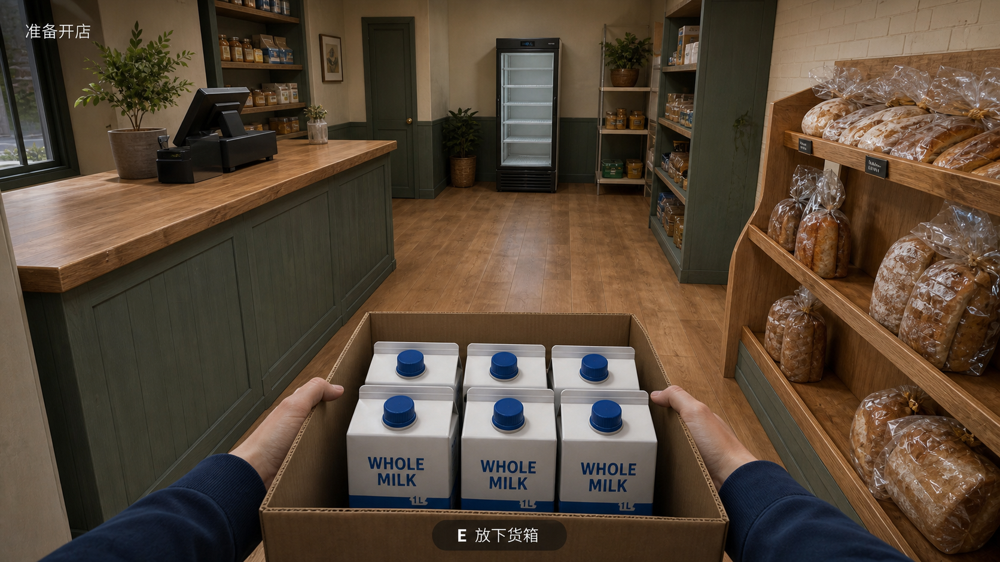
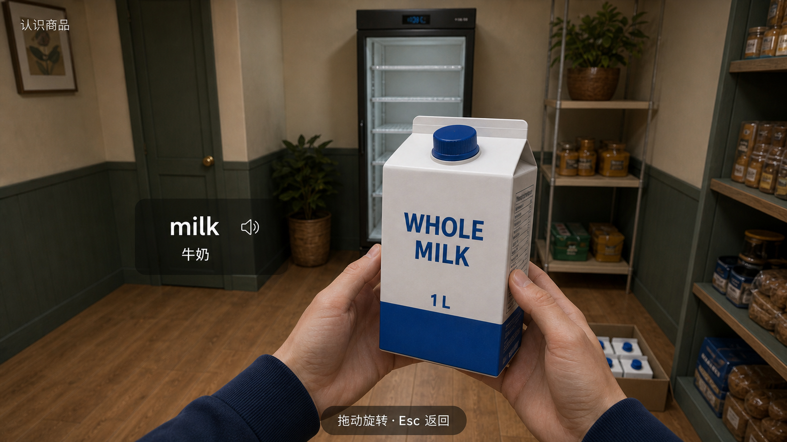
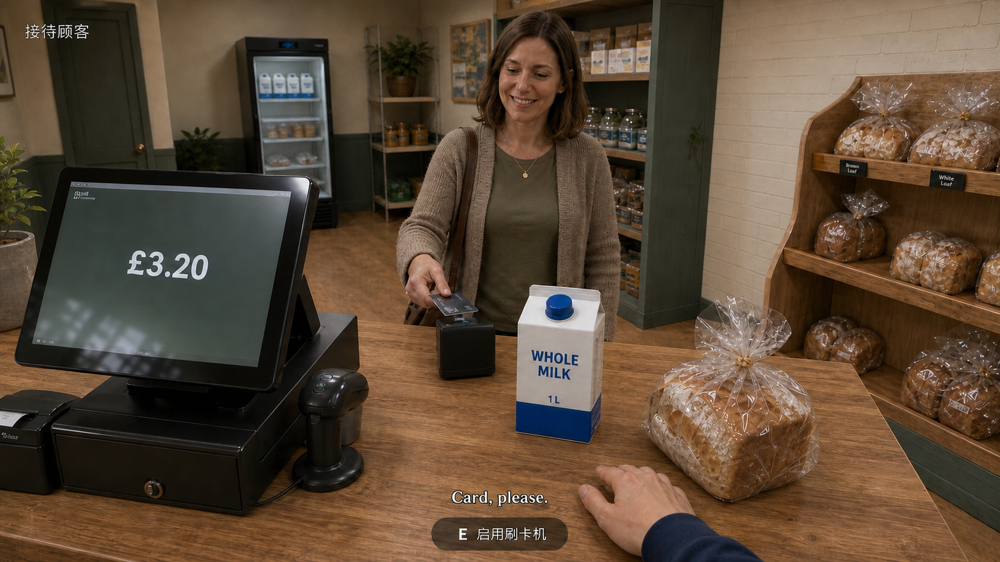

# 第一人称小卖部：三张关键分镜 V1

日期：2026-08-30\
状态：用户已确认整体视觉方向，由助手继续主导美术；三张图仍是概念分镜，不是可运行的 3D 游戏截图。绘制分镜时未修改游戏代码；后续需求已同步到 [PRD v0.2](../../PRD.md)。

## 视觉方向

真实比例、容易辨认的形状和材质、适度写实的第一人称 3D。用奶油白墙面、鼠尾草绿木作和暖木地面营造亲切的小店氛围。商品需经得起近看，不能只用换颜色的方块区分。

三张图是同一家店的连续操作状态，不是三个互斥风格。沿用同一款蓝盖、白底蓝色下沿的 1 L 奶盒，以及玩家的深蓝袖口。

## 分镜

| 图稿 | 场景与动作 | 英语学习与操作重点 |
| --- | --- | --- |
| [01-carry-crate.png](./01-carry-crate.png) | 玩家抱着首批货箱进入小店，能看到前方通道、右侧面包架和后方冰箱。 | 先理解空间和搬运；不在移动时弹词典或考试。 |
| [02-inspect-milk.png](./02-inspect-milk.png) | 放下货箱，在冰箱附近拿起一盒牛奶近看。 | 将 milk、读音入口和牛奶实物并置；中文作为辅助。 |
| [03-checkout.png](./03-checkout.png) | 上架和顾客购物之后，玩家站在收银台内，顾客带牛奶和面包来刷卡。 | 通过 Card, please. 与实际付款动作连接；首单不加入复杂找零。 |

### 01 · 抱箱子



### 02 · 近看商品



### 03 · 站在收银台后



三张图实际输出均为 1672 × 941 像素，近似 16:9。提示词中的 2048 × 1152 是请求目标，非实际输出尺寸；未做插值放大。

## 连续性与检查

- 从入口看，收银台在左、面包陈列在右、黑色立式玻璃冰箱在后；冰箱旁保留绿色门与窄货架等定位物。
- 第一张抱箱、第二张单品检查、第三张收银，摄像机应随玩家走到相应位置，而非移动场景中的设备。
- 后两张引用先前图稿维持商品、衣袖和材质语言的一致性。
- 收银画面已局部修正刷卡机朝向，使按键与显示面朝向顾客；主收银屏仍面向玩家。
- 已进行图像检查与独立复核：主体可识别、无明显多手或多指，中文主提示和关键英文可读；用户另已确认整体风格。
- 这些独立生成画面并非同一个 3D 场景的多机位渲染；细部几何和比例仍需在实际建模时统一。
- 结账金额 £3.20 仅是画面示例，未确定商品定价、成本或经济平衡。

## 美术落地边界

本轮使用内置图像生成工具制作概念分镜，没有调用付费素材购买流程，也没有使用 API/CLI 回退。

可以由助手主导统一美术方向、场景和商品外观设计、包装与贴图、界面图形，以及可用资产的制作、整理和游戏内整合。用户无需自行绘画，但仍需要确认整体风格与关键商品外观。

概念图不是模型资产，也不能保证游戏实时运行时逐像素复现图像。下一阶段需要把场景拆成可复用模型，处理网格、UV、材质、碰撞与交互锚点；角色还需骨骼与动作。复杂人物和动画可能需要适当授权的现成素材或额外制作工具。遇到能力限制、费用或授权不明之处须先向用户说明，不擅自购买。

建议先以一间小店、两种近看商品、一位顾客验证可运行的视觉质量与操作手感，再扩展商品数量。此项仅为建议，本轮未开始实现。

### 制作时须另行验证

- 商品真实大小及近距离轮廓：纸盒折角、瓶盖、面包表面、透明包装等需用合适的模型/材质表达。
- 同一模型在搬运、查看、上架、顾客拿取、收银各环节保持身份一致。
- 游戏提示、英文、字幕应由界面或明确的文本资产渲染，不能直接把概念图中的文字贴入所有视角。
- 图片中背景包装细字不是最终包装稿，需另行排版、检查并避免真实品牌和不明授权。
- 货箱不能遮挡导航；近看应可退出；收银设备应符合双方站位及手部操作。
- 本轮未验证引擎中的帧率、加载体积、灯光成本、动画质量或真实设备表现。

## 来源与文件

- 旧概念参考：[corner-shop-concept.jpg](../../../public/assets/corner-shop-concept.jpg)，仅借用温暖配色与材料氛围；未沿用其等距视角。
- 以下原件路径相对于本机 Codex 数据目录，不随本仓库上传；仓库内的最终图稿见本目录。
- 图 01 生成原件：`generated_images/01a04e05-f88f-73e3-b301-6e20db62756f/exec-dbd2dfe4-e7d4-40b6-bfeb-d31f26dbd0ae.png`
- 图 02 生成原件：`generated_images/01a04e05-f88f-73e3-b301-6e20db62756f/exec-1571d419-10cc-4960-a420-3818ea7ec172.png`
- 图 03 初版原件：`generated_images/01a04e05-f88f-73e3-b301-6e20db62756f/exec-525c16cb-dfd1-41c5-9e19-b22f1fd2a9ae.png`
- 图 03 最终原件：`generated_images/01a04e05-f88f-73e3-b301-6e20db62756f/exec-47e39773-88f5-4eee-a3be-5953d503a153.png`

最终三张已复制到本目录；生成原件保留。所有生成与局部修正均使用内置图像生成工具。

## 完整提示词

以下是实际提交的提示词，便于复用、修订和追溯；它们表达设计意图，不代表全部细节已严格满足。

### 图 01 · 抱箱子

输入参考：旧 corner-shop-concept.jpg，仅作氛围参考。

```text
Use case: stylized-concept.
Asset type: polished first-person 3D gameplay storyboard keyframe for an adult English-learning corner-shop simulator. This is a concept image, not an implemented game screenshot.
Direction name: Carrying the first delivery.
Input image: the attached old isometric shop image is a MOOD AND MATERIAL REFERENCE ONLY: cream walls, muted sage-green joinery, warm wood, welcoming British neighbourhood shop. The user has rejected its distant isometric viewpoint and overly simplified objects. Completely replace that camera and drawing style with the first-person 3D view specified below. Do not reproduce its HUD, floor grid, toy-like objects, or dollhouse composition.

Create a realistic, production-quality game screen design with clear hierarchy, intentional imagery and very restrained readable HUD. Show ONE focused gameplay moment, not a feature inventory. Do not add menus, dashboards, panels, inventory grids, cards, skill bars or decorative icons.

Target dimensions: 2048 x 1152 pixels, landscape 16:9, full-bleed gameplay viewport. No browser frame, no device mockup, no collage, no storyboard borders.

Scene: a SMALL approximately 4.5 m wide by 6 m deep British corner shop on its first morning. Looking from just inside the front entrance toward the rear wall: a simple sage-green checkout counter with oak worktop is on the LEFT near the entrance; a low wood-and-sage bread display is against the RIGHT wall; a single upright glass-door refrigerator is on the BACK wall. Maintain a broad uncluttered walkable centre aisle. This coherent layout will be reused in later frames. Cream plaster and a few cream brick surfaces, muted sage trim, oak laminate floor, a modest window plant. Soft clear daylight enters from the storefront behind the player. Warm, welcoming, not orange-tinted or cinematic.

Camera and subject: FIRST-PERSON EYE LEVEL, standing adult height about 1.65 m, modest natural wide angle without fisheye, looking slightly down enough to see an open corrugated cardboard grocery crate being carried in BOTH anatomically believable hands. Only the player's hands and navy cotton sleeves appear, not a third-person avatar. The crate sits in the LOWER QUARTER to lower third of the screen and does not obstruct the central aisle or destinations. Visible inside are several realistically proportioned 1-litre milk cartons with folded tops and BLUE screw caps, white coated paperboard with a restrained blue lower band. Front-facing cartons show the exact printed words 'WHOLE MILK' and '1 L'. Make their folded seams, cap shape and paperboard material easy to identify. The right shelf has only a few recognisable loaves in crinkled transparent bread bags, showing the real crust inside; no stacks of anonymous coloured blocks. The back fridge is mostly empty, ready for the carried milk.

Visual style: appealing moderately realistic REAL-TIME 3D GAME RENDER, suitable for a carefully art-directed indie shop simulator. Correct human and furniture scale, smooth detailed silhouettes, convincing but economical material detail. Cardboard corrugation and folds, paperboard carton seams, subtle skin texture, cloth sleeve folds, timber grain, transparent plastic, glass and metal should read distinctly. Good readable indirect lighting and contact shadows. Not low-poly geometric placeholders, not a painting, not an ultra-photoreal cinematic photograph or expensive AAA film still. Scene readability matters more than ornament. Keep the whole navigable space reasonably sharp, no heavy depth of field.

HUD: extremely minimal, crisp restrained sans-serif. A small upper-left task line reads exactly '准备开店'. At bottom centre a compact dark translucent pill with white type reads exactly 'E  放下货箱'. No other game HUD, no score, no glowing correct-answer objects, no floating labels over all products.
Constraints: actual recognisable groceries, physically plausible hand grip, both hands natural with correct fingers, no excess hands, no commercial brands, no large titles, no watermark. Preserve the approved warm material language but follow the NEW first-person spatial layout and realistic product treatment.
```

### 图 02 · 近看商品

输入参考：图 01 生成原件。

```text
Use case: stylized-concept.
Asset type: polished first-person 3D gameplay storyboard keyframe for the same adult English-learning corner-shop simulator.
Direction name: Recognising the milk in your hands.
Input image: Image 1 is the approved scene-and-product continuity anchor from the immediately preceding carrying-crate frame. Preserve this SPECIFIC small shop, its cream upper walls, sage-green panelling and doors, oak floor, BLACK upright glass-door refrigerator, realistic navy sleeves and natural hand appearance. Preserve the EXACT recognisable white 1-litre milk carton design with BLUE cap, folded paperboard top, dark-blue 'WHOLE MILK' lettering and restrained blue lower band. It is a continuity reference, not a request to keep the old carrying pose or camera position.

Create a realistic, production-quality focused game screen with clear hierarchy and restrained readable UI. This is ONE new storyboard image in the same visual direction, not a style alternative, not a collage or multi-panel page.
Target dimensions: 2048 x 1152 pixels, landscape 16:9, full-bleed gameplay viewport, no device frame, no browser chrome.

Scene and camera: the player has walked down the SAME centre aisle to the back refrigerator, put the cardboard crate down, and deliberately entered an item-inspection mode. Standing FIRST-PERSON eye-level viewpoint looking slightly downward, close enough to study one milk carton held naturally in two hands. The same black fridge is on the back wall behind the item; the sage utility door from the reference remains to its LEFT, and the slim small grocery rack remains to its RIGHT. The checkout and front bread display are now behind the camera, NOT teleported beside the fridge. Keep these background landmarks recognisable but gently less sharp than the product, not heavy cinematic blur.

Main subject: ONE 1-litre milk carton held at a comfortable reading distance in both anatomically plausible hands with navy cotton cuffs. The carton occupies roughly HALF the image height, slightly right of centre with its front and a narrow side visible, allowing the folded top, blue cap, paperboard seams and printed label to be clearly understood. Natural fingers support the lower sides and base without covering the words. Do not enlarge it into a giant container. Realistic matte coated paperboard, blue plastic cap with ridges and small natural reflections. The exact main package text is 'WHOLE MILK', with '1 L' beneath. No fictional brand or unrelated advertising. One cropped corner of the open delivery box may be visible at the lower background, resting on a low shelf or floor, not floating in the player's hands.

Art direction: match the reference's appealing moderately realistic real-time 3D materials and subdued cream/sage/oak palette; detailed enough to recognise everyday objects close up, not generic coloured cubes, not cartoon outlines, not a film photograph. Improve subject illumination slightly so the product shape and label are easy to read. Maintain the same clear soft daytime lighting and believable human proportions. No extra actors.

Minimal learning interface: small upper-left task text exactly '认识商品'. In the uncluttered area immediately LEFT of the held carton, a modest translucent charcoal vocabulary caption shows 'milk' in larger white lowercase letters and '牛奶' smaller below it, with a simple speaker playback icon beside the word. It should feel attached to the act of looking at the object, not like a huge dictionary window. At bottom centre, one small dark pill reads exactly '拖动旋转 · Esc 返回'. No question, no answer options, no scoring, no progress bars, no feature cards or inventory. No extra UI.
Constraints: keep the same carton identity, same clothes, same back-wall layout and scale as reference; close inspection must reveal recognisable physical features. Exactly two player hands with natural anatomy. No third-person avatar, no isometric view, no watermark or large title.
```

### 图 03 · 收银初版

输入参考：图 01 和图 02 生成原件。

```text
Use case: stylized-concept.
Asset type: polished first-person 3D gameplay storyboard keyframe for the same adult English-learning corner-shop simulator.
Direction name: The first customer at the till.
Input image roles: Image 1 is the room-layout and art-direction continuity anchor: the entrance view with the sage-green checkout along the LEFT wall, low bread display on the RIGHT, black upright refrigerator on the BACK wall, sage utility door to the fridge's LEFT and slim grocery rack to its RIGHT. Image 2 is the close-up product and player appearance continuity anchor: the same white 1-litre milk carton with BLUE screw cap, folded top, dark-blue 'WHOLE MILK' lettering, '1 L', and blue lower band; navy cotton sleeves and natural human hands. Preserve this SAME shop, same products, same time-of-day lighting. This is a third consecutive action frame, NOT a style alternative.

Create a realistic, production-quality focused gameplay screen with exceptionally clear spatial hierarchy and extremely restrained HUD. ONE storyboard image only. No collage, no storyboard border, no device mockup, no browser chrome.
Target dimensions: 2048 x 1152 pixels, landscape 16:9, full-bleed gameplay viewport.

Camera and room continuity: the player has now moved BEHIND the existing LEFT-wall checkout, standing in the cashier space between the counter and the left storefront/window wall. FIRST-PERSON adult eye-level, looking diagonally across the oak worktop toward a customer in the central aisle and slightly toward the rear of the shop. The viewpoint has genuinely moved from the aisle into the cashier position. The sage-green counter with oak worktop spans the lower third. Across the aisle, the RIGHT-wall bread display remains visible to the right background. The SAME black glass-door fridge on the back wall is visible toward the left/rear background, now holding a few of the same milk cartons because stocking has happened. Cream plaster walls, sage lower wall panels and joinery, warm oak floor, soft clear daylight. Avoid adding extra checkout lanes or enlarging the shop. Maintain believable compact corner-shop scale.

Main action: one friendly ordinary adult woman customer, roughly 35-45, wearing a muted earth-tone cardigan or casual jacket, stands naturally on the OPPOSITE customer side of the counter. Realistic human proportions and understated game-character detailing, not fashion-model posing, not toy-like or cartoon. The first purchase is ready for card payment. She holds a payment card close to a compact card reader on HER side of the countertop; her other hand can simply rest naturally near her shopping. Show the payment reader facing and reachable by her. On the worktop sit exactly one recognisable white-and-blue milk carton matching Image 2 and one loaf of bread in a crinkled clear plastic bag with visible brown crust and realistic soft bread shape. Both are well illuminated and clearly identifiable.

Checkout equipment: a modest black cashier POS screen on the PLAYER side, angled naturally toward the player, a small practical barcode scanner, and the compact customer-facing card reader. They must feel connected to a workable checkout flow, not a confusing wall of monitors. On the POS display show the exact large readable transaction amount '£3.20', with very little other screen text. Keep scanner, milk, bread, terminal and customer from obscuring one another. One natural player RIGHT hand with the same navy sleeve can rest beside the POS as if confirming card payment. The other player hand is out of frame. Hands must be anatomically plausible, not blended with the customer's hands. No crate in the player's arms; no floating props.

Visual style: match the two references' appealing moderately realistic real-time 3D game materials, correct human and furniture scale, cream/sage/oak palette and readable soft daytime lighting. Realistic coated paperboard seams, plastic cap ridges, bread crust through transparent packaging, natural wood grain, subdued glass reflections, metal and plastic equipment. A polished achievable indie-game visual target, not a photograph, not expensive cinematic effects. Medium-to-deep readable focus, no dramatic bloom, no saturated orange light, no giant glowing correct answers.

HUD: tiny upper-left task text exactly '接待顾客'. In the lower centre, a clean small subtitle reads exactly 'Card, please.' Above or beneath it, a separate restrained compact dark translucent action pill reads exactly 'E  启用刷卡机'. No huge text overlay, no dialogue menu, no answer options, no quiz, no dictionary popup, no experience bars or inventory windows. The user's attention should remain on the physical customer and transaction.
Constraints: same shop landmarks and furniture identity, same milk packaging and player clothing, same first-person art direction; clear separation of cashier side and customer side. No commercial brands, no watermark, no large title, no third-person player avatar.
```

### 图 03 · 刷卡机朝向修正

输入参考：图 03 初版生成原件。修正输出作为最终 03-checkout.png。

```text
Use case: stylized-concept, tightly scoped correction to an existing game storyboard.
Edit ONLY the compact payment card reader on the countertop directly in front of the customer, and minimally adjust her card-holding hand if necessary for the gesture to remain natural.

Rotate this ONE card reader 180 degrees horizontally in place so its display and keypad face the CUSTOMER, not the first-person cashier/viewer. The camera should mainly see the black rear casing of the reader and the back/edge of its raised display. The customer should still be able to tap her card above the contactless surface at the top, toward her side. Keep the card reader physically plausible and firmly on the counter, no extra machine and no floating parts.

PRESERVE EVERYTHING ELSE from the source image exactly: the same first-person cashier camera, crop, shop room, sage door, black fridge, oak countertop, wooden bread display, customer face and clothes, player navy cuff and hand, scanner and large POS screen at left with '£3.20', white-and-blue milk carton with 'WHOLE MILK' and '1 L', bread loaf in clear bag, lighting, colours, texture quality and realistic proportions. Preserve the upper-left Chinese text '接待顾客', subtitle 'Card, please.', and bottom hint 'E  启用刷卡机'. Do not change the art style, add objects, or redesign the room. The only goal is to make the payment terminal usable from the CUSTOMER side.
```
